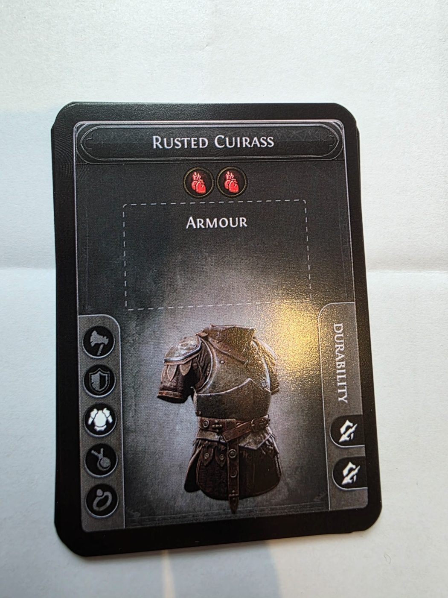
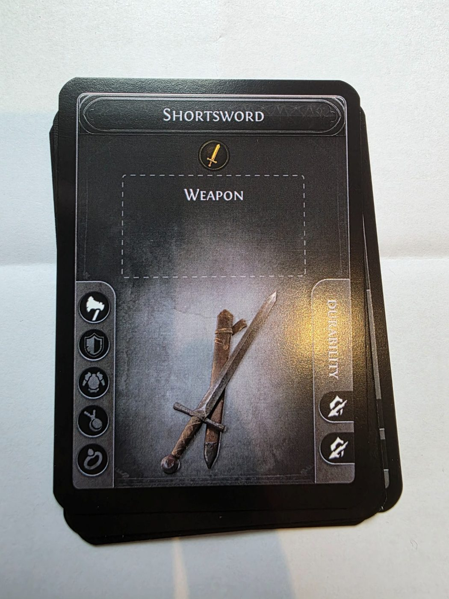
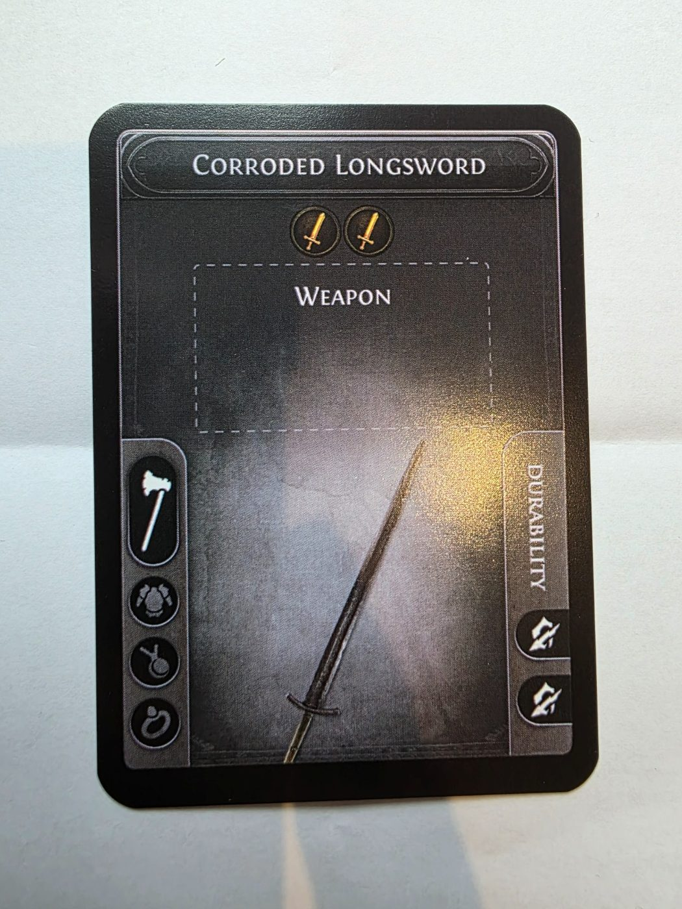
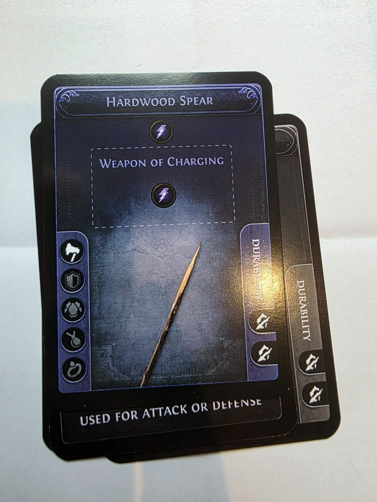
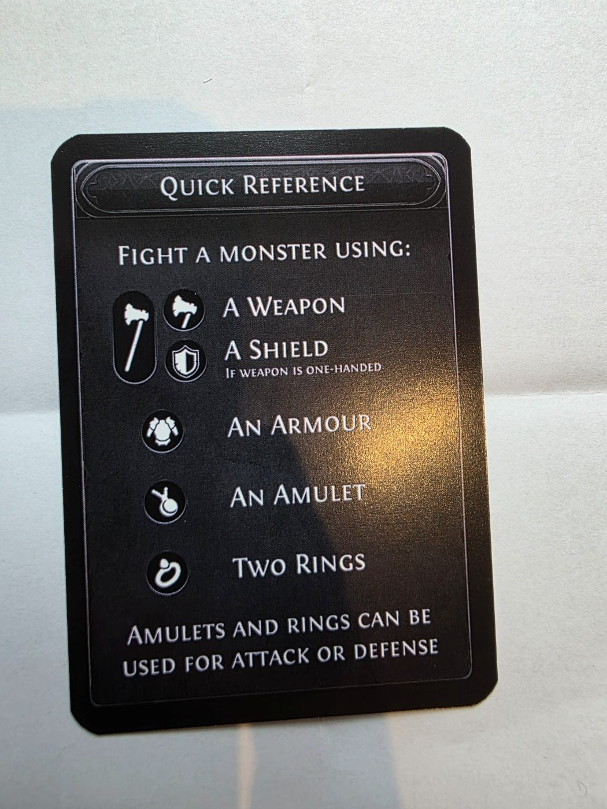

# Cards and symbols

Every card in your deck is an **Item**. This page explains how to read one.

## Anatomy of an item card

| Part | Where | What it tells you |
| --- | --- | --- |
| Name | Banner across the top | The item's name, e.g. *Rusted Cuirass*. The banner and border colour show its rarity. |
| Symbols | Row of round icons under the name | What the item contributes to a fight. Each icon is one symbol. |
| Type box | Dashed box in the middle | The item type (*Weapon*, *Shield*, *Armour*, …). On magic items it also holds the modifier name and its extra symbols. |
| Slot icons | Column down the left edge | The slot the item goes in. The highlighted icon is this item's slot. |
| Durability | Column down the right edge | One pip per point of durability. Staff clip a pip when the item takes Damage. |

## Rarity

The frame colour shows the rarity, just like item rarity in Path of Exile.

| Rarity | Frame | Notes |
| --- | --- | --- |
| Normal | Grey/white | Base symbols only. Most starter cards are normal. |
| Magic | Blue | Has a named modifier, such as *Weapon of Charging*, that adds symbols in the type box. |
| Rare | — | Players report getting rares in some starter packs. None was photographed for this repo. |
| Unique | — | Exist as loot. In 2023, players got unique cards (e.g. Headhunter) signed by staff. |

All item cards use Path of Exile 2 base types. Players have seen swords, spears, bows, maces, shields and body armours so far.

## Symbols

Symbols are the core of the game. Every symbol on the items you use counts toward your Attack or your Defence.

| Symbol | Looks like | Seen on |
| --- | --- | --- |
| Sword | Gold sword. Players call it "phys". | Shortsword, Corroded Longsword, monster Defence |
| Fire | Red/orange flames | Monster Defence, other players' weapons |
| Cold | Blue snowflake | Monster Attack |
| Lightning | Purple bolt | Hardwood Spear |
| Life | Red heart | Rusted Cuirass |
| Block | Orange shield emblem | Splintered Tower Shield |
| Number | Grey circle with a digit (monsters only) | Monster Attack and Defence |

The number only appears on monsters. It means "this many more symbols of any kind" (see [Fighting monsters](fighting-monsters.md)).

> **Unconfirmed:** 2023 shirts also showed a purple skull symbol (probably Chaos). Nobody has reported it on a 2026 card yet. Whether Block and Life behave differently from the other symbols is also an [open question](../faq.md#open-questions).

## Slot icons and one- vs two-handed weapons

The left column always shows the slots in the same order: **weapon** (axe), **shield**, **armour** (body armour), **amulet** and **ring**. The item's own slot is highlighted.

- **One-handed weapons** have a small axe icon, with the shield icon still shown below it. You can carry a shield alongside them.
- **Two-handed weapons** have one tall axe icon that covers the space where the shield icon would be. You cannot use a shield with them.

| One-handed (Shortsword) | Two-handed (Corroded Longsword) |
| --- | --- |
|  |  |

## Durability

Every card photographed so far has **2 durability pips**. When a monster deals Damage to an item, the staff member clips a pip. **Once an item has taken two Damage it can no longer be used.**

## Cards photographed for this repo

| Card | Rarity | Slot | Hands | Symbols | Durability |
| --- | --- | --- | --- | --- | --- |
| Shortsword | Normal | Weapon | One-handed | Sword | 2 |
| Corroded Longsword | Normal | Weapon | Two-handed | Sword, Sword | 2 |
| Hardwood Spear | Magic, *Weapon of Charging* | Weapon | One-handed | Lightning (base) + Lightning (modifier) | 2 |
| Splintered Tower Shield | Normal | Shield | — | Block | 2 |
| Rusted Cuirass | Normal | Armour | — | Life, Life | 2 |

## Quick Reference card

Each starter pack includes a Quick Reference card. It lists what you can fight with: a weapon, a shield (only if the weapon is one-handed), an armour, an amulet and two rings. It also reminds you that amulets and rings can count toward either Attack or Defence. The full loadout rules are in [Equipment](equipment.md).

