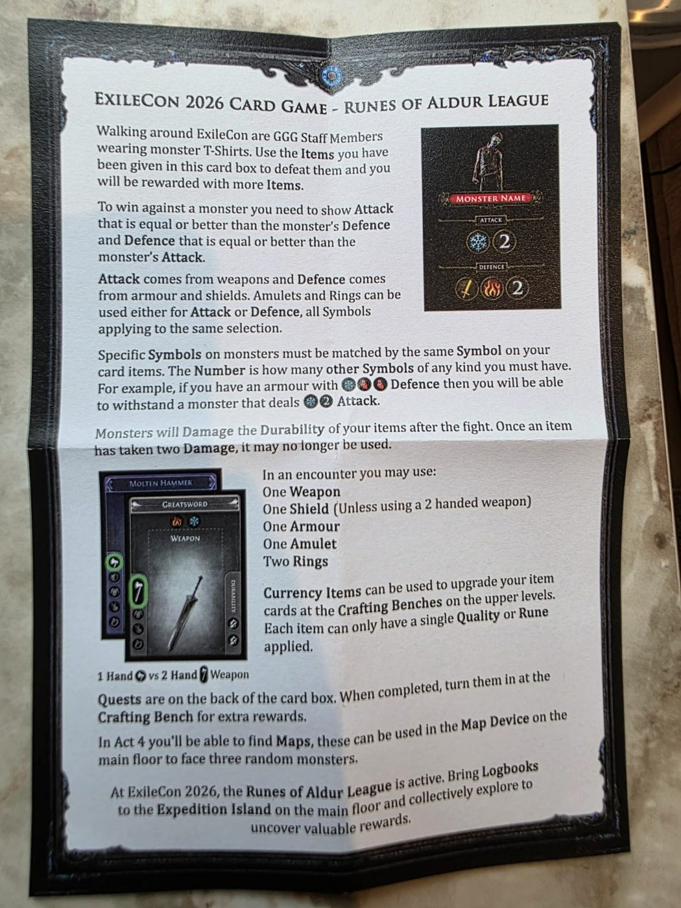

# Fighting monsters

## Who the monsters are

The monsters are **GGG staff members wearing monster T-shirts** who walk around the venue. Each shirt shows:

- the monster's **name**,
- its **Attack**: the symbols you must withstand,
- its **Defence**: the symbols you must overcome,
- *(new in 2026)* the **act** the monster belongs to, so you can see where it fits in your progression.

Monsters are spread around the venue rather than grouped by floor or act. On the first day, look for queues to find the early monsters.

## Reading a monster's stat

A monster's Attack or Defence is a row of symbols, often ending in a **number**:

- Each **specific symbol** (Fire, Cold, Sword, …) must be matched by **the same symbol** on your side.
- The **number** is how many **additional symbols of any kind** you must also have.

So the total number of symbols you need is the specific symbols **plus** the number.

## How to win

You win a fight when **both** of these are true:

1. Your **Attack** is equal to or better than the monster's **Defence**.
2. Your **Defence** is equal to or better than the monster's **Attack**.

Check each side on its own, using only the symbols assigned to that side.

### Checking one side, step by step

1. Lay out the symbols on the items you're using for that side.
2. For each specific symbol on the monster, set aside one matching symbol of yours. If you can't match one, you fail this side.
3. Count your remaining symbols, whatever their type. If that count is at least the monster's number, you pass this side.

Each of your symbols counts once. A symbol used to match a specific symbol can't also count toward the number.

### Worked examples

**Example A, from the rules leaflet.** The monster's Attack is **Cold + 2**. Your Defence is an armour with **Cold, Life, Life**.

- Cold matches Cold.
- Life and Life are 2 more symbols, which covers the **2**.
- ✅ You withstand the attack.

**Example B, also from the leaflet.** The monster's Defence is **Sword + Fire + 2**. You need a Sword, a Fire **and** two more symbols of any kind: **four symbols** on your Attack side.

- A Corroded Longsword alone (Sword, Sword) gives you the Sword and one extra symbol, but no Fire. ❌
- Add a ring with a Fire symbol, assigned to Attack: Sword ✔, Fire ✔, one extra Sword. That's 1 of the 2 extra symbols. ❌
- Add an amulet with any symbol, also assigned to Attack: now you have 2 extra symbols. ✅

(The ring and amulet here are hypothetical, to show the counting.)

**Example C, specific symbols matter.** The monster's Attack is **Cold + 2**. Your Defence is a Rusted Cuirass (Life, Life) and a Splintered Tower Shield (Block).

- You have 3 symbols, but none of them is Cold.
- ❌ You fail. Having more symbols than the monster's total doesn't help if you're missing a specific one.

**Example D, a bigger number.** A stat written as **4 + Fire + Fire** means two Fire symbols **plus** four more of anything: six symbols in total.

## After the fight

### If you win

- **Your items take Damage.** The staff member clips durability on one or more of the items you used. How many items, and which ones, depends on the monster. In 2023 each staff member had instructions such as "clip all items" or a fixed clipping order.
- **You get loot.** The staff member draws cards from their **loot deck** and you keep some. Usually they draw two and you pick one, but it depends on the monster. (A 2023 sheet showed a high-tier monster as "draw 3, pick 1".)
- Players' rule of thumb from 2023: a typical win costs about 3 durability and gives you about 2 new cards with 2 durability each. Pick your fights and you come out ahead overall.

### If you lose

You **can't die**. If you lose, you're assumed to have fled. **Your cards only take Damage when you win**, so a loss costs you nothing but time. Maps are the exception (see [Progression](progression.md#maps)).

## Who you can fight

- **Any monster, in any order.** You don't need to beat the Act 1 monsters before challenging Act 2. Quests can also be done in any order.
- **Not the same staff member over and over.** You can't repeatedly fight the same staff member. Players suggest rotating between two or three monsters at your level. How long you must wait before a rematch hasn't been stated.

## Etiquette and practical tips

- Low-level monsters attract **long queues**, especially early on day 1.
- You're encouraged to talk to the staff you fight and to get cards signed. Getting to know the developers is part of the point.
- Keep your cards on you. A player's whole deck was stolen at a previous ExileCon when they left it unattended.
